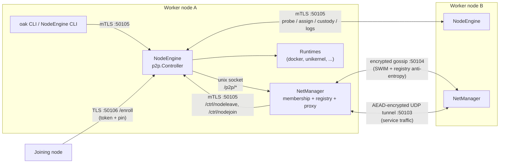
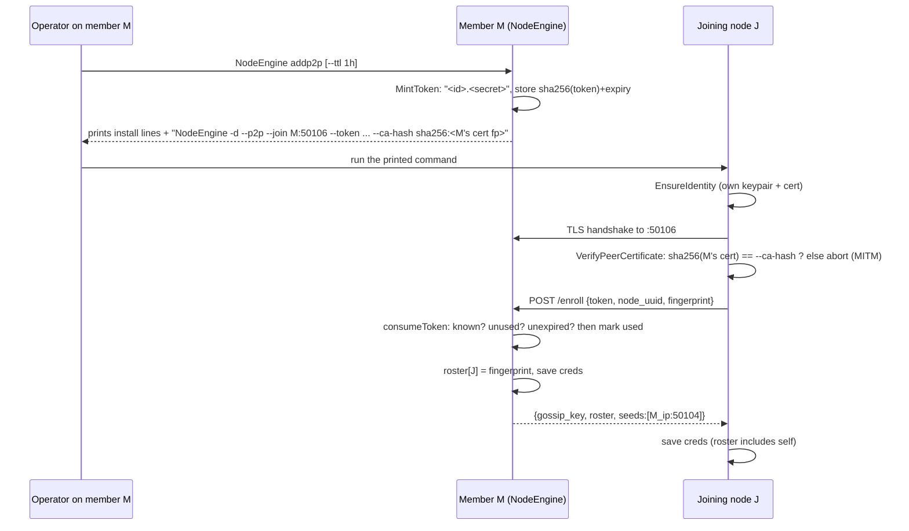
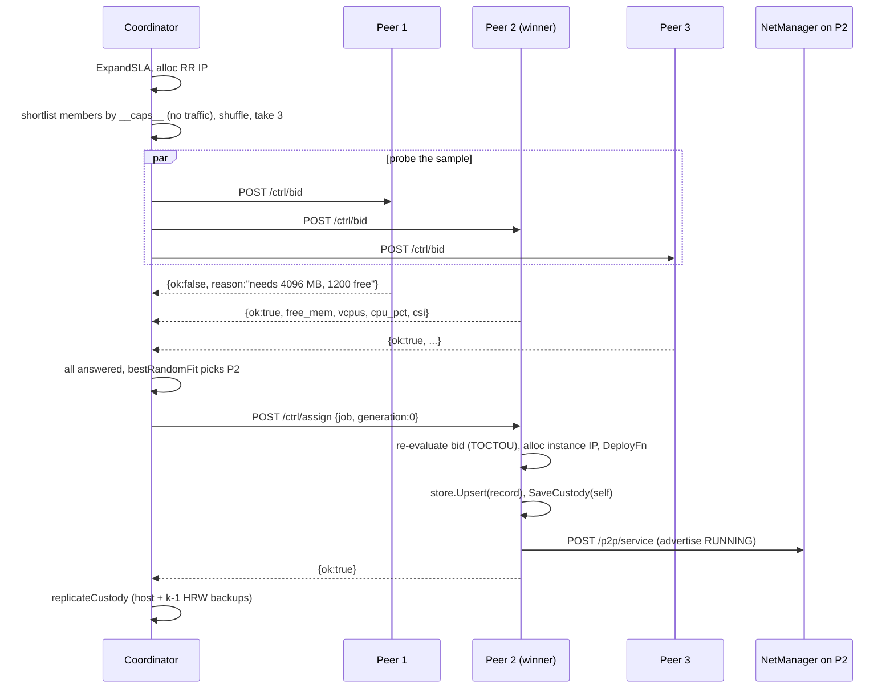
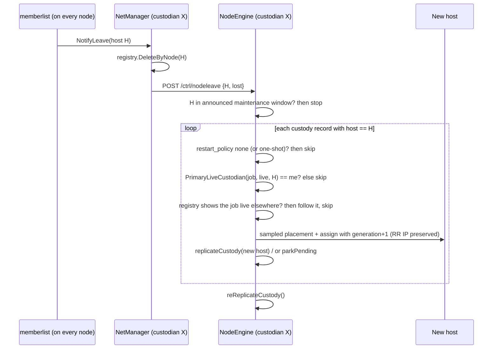

# Oakestra P2P Mode

P2P mode lets Oakestra workers run as a **self-organising mesh with no root or cluster
orchestrator**. Every worker is a full peer: it can accept a deployment, run the scheduling
round, host workloads, keep backup copies of other nodes' SLAs, and take over a dead node's
work. The same SLA files, the same `oak` CLI commands and the same overlay network (ServiceIPs,
round-robin, the `:50103` tunnel) work in both modes.

This document explains how the mode works end to end and how the components interact. It
describes the code as built; file references point to where each mechanism lives.

---

## Contents

1. [Cluster mode vs. P2P mode](#1-cluster-mode-vs-p2p-mode)
2. [Components and responsibilities](#2-components-and-responsibilities)
3. [Ports and on-disk state](#3-ports-and-on-disk-state)
4. [Node lifecycle: genesis, join, re-join](#4-node-lifecycle-genesis-join-re-join)
5. [Security model](#5-security-model)
6. [Membership and discovery](#6-membership-and-discovery)
7. [The gossiped service registry](#7-the-gossiped-service-registry)
8. [Deploying a service: sampled placement](#8-deploying-a-service-sampled-placement)
9. [Addressing and the data plane](#9-addressing-and-the-data-plane)
10. [Failure handling](#10-failure-handling)
11. [Using the oak CLI](#11-using-the-oak-cli)
12. [Operating a P2P network](#12-operating-a-p2p-network)
13. [Reference](#13-reference)
14. [Changes that also affect cluster mode](#14-changes-that-also-affect-cluster-mode)
15. [Known limitations](#15-known-limitations)

---

## 1. Cluster mode vs. P2P mode

| Concern | Cluster mode | P2P mode |
|---|---|---|
| Control plane | Root → cluster orchestrator → worker over MQTT | Worker ↔ worker over a mutually authenticated HTTPS control API (`:50105`) |
| Who schedules | Root + cluster schedulers | Whichever peer received the request: it shortlists matching peers locally and asks a **few random ones** for room |
| Membership | Cluster handshake; the cluster assigns the node ID | SWIM gossip (`hashicorp/memberlist`); the node generates a stable `node_uuid` |
| Service discovery | MQTT table query to the cluster service manager | Local lookup in a **gossip-replicated registry** |
| ServiceIP allocation | Root service manager | Each node draws from its own `/24` inside `10.30.0.0/16` |
| Failover | Cluster re-deploys FAILED instances | The job's **custodians** (HRW-selected peers holding the SLA) reschedule it |
| Persistence | None needed (the cluster owns placement) | Each node persists what it hosts and reclaims it after a reboot |
| Trust | MQTT certs, root login/JWT | Self-signed node certs + a gossiped member roster; join tokens; shared PSK |

A worker runs in exactly one mode at a time. The mode is stored in `/etc/oakestra/conf.json`
(`"mode": "p2p" | "cluster"`, cluster by default). See [§12](#12-operating-a-p2p-network) for switching.

---

## 2. Components and responsibilities



### NodeEngine (`oakestra/go_node_engine`)

The NodeEngine is the **p2p brain**. In p2p mode the daemon skips the cluster handshake and MQTT
entirely and instead starts a `p2p.Controller` ([p2p/control.go](node_engine/p2p/control.go)), which
plays four roles at once:

| Role | What it does | Code |
|---|---|---|
| **Coordinator** | Receives an SLA, expands it into jobs, shortlists and samples members, assigns each job to a winner | `DeploySLA`, `ScheduleJob` in [coordinator.go](node_engine/p2p/coordinator.go) |
| **Host** | Answers placement probes, re-checks capacity on assign, allocates the instance IP, deploys, persists, advertises | `evaluateBid`, `handleAssign` |
| **Custodian** | Stores SLA copies for jobs on other nodes; reschedules them if their host dies; retries PENDING jobs; stops its own copy of a duplicated job | [custody.go](node_engine/p2p/custody.go), `handleNodeLeave`, `retryPending`, [duplicates.go](node_engine/p2p/duplicates.go) |
| **Observability endpoint** | Network-wide `services ls`, log proxying, capacity sweep, root-API compatibility for `oak` | `servicesHandler`, `logsHandler`, `capacityHandler`, `/api/*` handlers |

It also owns the node's **identity and trust state** ([enroll.go](node_engine/p2p/enroll.go),
[tlsauth.go](node_engine/p2p/tlsauth.go)): keypair, self-signed cert, roster, join tokens, and the
enrollment endpoint.

### NetManager (`oakestra-net/node-net-manager`)

The NetManager owns **everything that is gossip or packets**:

- **Membership**: a memberlist instance, keyed with the network PSK
  ([p2p/membership.go](../oakestra-net/node-net-manager/p2p/membership.go)).
- **Registry**: the replicated map of who hosts what
  ([p2p/registry.go](../oakestra-net/node-net-manager/p2p/registry.go)).
- **Resolver**: replaces the MQTT table query when the proxy needs to resolve a ServiceIP
  ([p2p/resolver.go](../oakestra-net/node-net-manager/p2p/resolver.go)).
- **Discovery**: mDNS advertise/browse for re-joining after the node ends up alone
  ([p2p/discovery.go](../oakestra-net/node-net-manager/p2p/discovery.go)).
- **Proxy tunnel**: the existing `:50103` UDP overlay, now with AEAD payload encryption and
  table-entry-based forwarding.

It exposes the mesh to the paired NodeEngine through local-only endpoints
([server/p2pRoutes.go](../oakestra-net/node-net-manager/server/p2pRoutes.go)) and pushes membership
events back to the NodeEngine.

**Division of labour:** the NetManager knows *who is alive* and *what is advertised*. It never
makes scheduling decisions. The NodeEngine makes every decision but reads membership and the
registry only through the NetManager.

### Scheduler module (`oakestra/scheduler`)

Placement picks among the sampled members with room using **`bestRandomFit`**: it scores candidates with the same
CPU/memory fit used by `bestCpuMemFit`, then picks **at random among the candidates within a
tolerance of the best score**. The randomness spreads load when many coordinators decide at the
same time on similar data. The shared filtering lives in `schedulers/cpumemfit`/`placement`. The
NodeEngine imports the module via a `replace scheduler => ../scheduler` directive and adapts it in
[p2p/scheduling/scheduling.go](node_engine/p2p/scheduling/scheduling.go). GPU fit is filtered
there first, because the shared scheduler has no GPU dimension.

### oak CLI (`oakestra-cli`, Python and Go)

Both CLIs detect p2p mode from `/etc/oakestra/conf.json`. On a p2p worker, `oak app` / `oak service`
talk to the **local** control API (`https://127.0.0.1:50105`) over mTLS with the node's identity,
and skip login. See [§11](#11-using-the-oak-cli).

### Root/cluster service managers (`oakestra-net`)

They are not used in p2p mode. They changed only because of the shared-subnet work that both modes
now use ([§14](#14-changes-that-also-affect-cluster-mode)).

---

## 3. Ports and on-disk state

| Port | Proto | Owner | Purpose | Auth |
|---|---|---|---|---|
| `50103` | UDP | NetManager | Overlay tunnel for service traffic (unchanged port) | XChaCha20-Poly1305 with a key derived from the PSK |
| `50104` | TCP+UDP | NetManager | memberlist gossip: SWIM probes and registry push/pull | AES-GCM with the PSK (memberlist keyring) |
| `50105` | TCP | NodeEngine | Control API: peer RPCs, CLI, NetManager notifications | Mutual TLS, roster-pinned |
| `50106` | TCP | NodeEngine | Enrollment endpoint (`/enroll`) | Server TLS (pinned by the joiner) + single-use token |
| unix socket / local port | HTTP | NetManager | NodeEngine ↔ NetManager (`/register`, `/p2p/*`) | Local only |

All of `50103–50106` must be reachable between peers. mDNS (UDP 5353 multicast) is optional.

| Path | Contents |
|---|---|
| `/etc/oakestra/conf.json` | `mode`, `node_uuid`, and the `p2p` block ([§13.3](#133-configuration-p2p-block-of-etcoakestraconfjson)). Holds one-shot join parameters until enrollment succeeds. |
| `/etc/oakestra/p2p/node.key`, `node.crt` | The node's ECDSA P-256 key and self-signed cert (`0600`). The key never leaves the node. |
| `/etc/oakestra/p2p/creds.json` | Gossip PSK, roster (`node_uuid → sha256 fingerprint`), seed list (`0600`). |
| `/etc/oakestra/p2p/tokens.json` | Join tokens this node minted. Stores **hashes only**, with expiry and used flag. |
| `/var/lib/oakestra/deployments.json` | What this node hosts: service, RR IP, instance IP, generation, desired state. Used for reboot recovery. |
| `/var/lib/oakestra/ipam.json` | IPs allocated from this node's `/24`. |
| `/var/lib/oakestra/custodian/<job>.json` | Custody records: SLA copies for jobs this node is a custodian of, including PENDING jobs. |

(`/var/lib/oakestra` honours `XDG_STATE_HOME`.)

---

## 4. Node lifecycle: genesis, join, re-join

### 4.1 Starting a node

There are three ways to start a node, all on the NodeEngine root command:

```bash
# Genesis: create a brand-new network on this node
NodeEngine -d --p2p --init

# Join: the exact line printed by `NodeEngine addp2p` on any existing member
NodeEngine -d --p2p --join 192.168.1.10:50106 --token 3fa9c1.8e2b... --ca-hash sha256:ab12...

# Re-join / restart: use the stored credentials
NodeEngine -d --p2p
```

`--p2p` (or `NodeEngine config mode p2p ...`) runs `applyP2PStartup` ([cmd/mode.go](node_engine/cmd/mode.go)),
which:

1. Validates flags: `--join` requires `--token` and `--ca-hash`, and `--init` and `--join` are mutually exclusive.
2. Sets `mode = p2p` and fills in the p2p defaults if they are missing.
3. Generates a stable `node_uuid` if the node has none. This replaces the cluster-assigned ID as
   the node's identity everywhere: memberlist name, cert CN, roster key, registry `node_uuid`.
4. Stores the join parameters in `p2p.pending_enroll`. They are **single-use** and the daemon clears
   them after enrollment succeeds.

### 4.2 Daemon boot sequence (p2p)

[internal/daemon/nodeengined.go](node_engine/internal/daemon/nodeengined.go):

```mermaid
sequenceDiagram
    participant NE as NodeEngine daemon
    participant Peer as Bootstrap member
    participant NM as NetManager
    NE->>NE: model.SetNodeId(node_uuid) (no cluster handshake)
    alt pending --init
        NE->>NE: Genesis(): keypair+cert, mint 32-byte PSK, roster={self}
    else pending --join
        NE->>Peer: POST https://join/enroll {token, node_uuid, fingerprint}
        Peer-->>NE: {gossip_key, roster, seeds}
    end
    NE->>NE: clear pending_enroll
    opt no creds at all (bare --p2p on a fresh node)
        NE->>NE: Genesis()
    end
    NE->>NE: go ServeEnrollment(:50106)
    NE->>NM: systemctl start netmanager, then POST /register {mode:p2p, client_id, gossip_key, seeds, gossip_port, control_port}
    NM->>NM: StartMembership(PSK, seeds), registry, resolver, mDNS, proxy (AEAD), env (fixed subnet)
    NE->>NE: NewController, go Serve() (:50105, mTLS)
    NE->>NE: NodeStatusUpdater (keeps local CPU/mem fresh for bids; no MQTT)
    NE->>NM: AnnounceRoster(): advertise __roster__ entry with own fingerprint
    NE->>NM: AnnounceCapabilities(): advertise __caps__ entry, re-sent when it changes
    NE->>NM: ReconcileP2P(): read registry, restore or yield persisted jobs
```

Notes:

- A bare `--p2p` on a node with no credentials **bootstraps a new network**, the same as `--init`.
  This is intentional for single-node use. To join an existing network, pass `--join`.
- The NetManager receives the gossip PSK and seeds in its `/register` call
  ([requests/NetManagerRequests.go](node_engine/requests/NetManagerRequests.go)). Seeds are
  `p2p.bootstrap_peers` plus the seeds returned by enrollment. The `--join` address is the
  *enrollment* endpoint (`:50106`), not a gossip seed. The seed comes back from enrollment as
  `<member-ip>:50104`.
- `nodeengine.service` is ordered `After/Wants=netmanager`, and both units are enabled so a reboot
  brings the node back into the mesh unattended.

### 4.3 NetManager registration

[server/server.go](../oakestra-net/node-net-manager/server/server.go) branches on `mode`:

- `registerCluster`: unchanged MQTT path, now on the fixed shared subnet.
- `registerP2P`:
  - sets `model.P2PMode = true`, so every MQTT-dependent path (deployment status, interest
    registration, address-change notifications) is skipped. There is no MQTT client in p2p mode.
  - starts memberlist with `DeriveGossipKey(gossip_key)` and the seeds, and wires `OnNodeLeave` /
    `OnNodeJoin` to POST `/ctrl/nodeleave` / `/ctrl/nodejoin` on the local NodeEngine.
  - creates the registry and the resolver, and starts the mDNS loop.
  - creates the proxy with `EnableDataEncryption(DeriveDataKey(gossip_key))`.
  - creates the environment on the fixed shared subnet and points its resolver at the p2p
    registry with `Env.Resolver().UseBackend(...)`, so cold lookups and interests go to the
    registry instead of MQTT.
  - starts `p2pRouteRefreshLoop` (every 5 s, see [§9.4](#94-keeping-routes-fresh)).

Both modes then run the same `startDatapath` step. It tells the translation table which node it
runs on, connects the proxy to the resolver, and starts the proxy's read loops.

---

## 5. Security model

P2P mode has **no CA**. Trust is **membership in a roster of certificate fingerprints**, and the roster
is distributed over the gossip channel, which is itself authenticated by a shared PSK. There are two
independent cryptographic gates:

| Plane | Gate | What it protects |
|---|---|---|
| Gossip (`:50104`) | Shared PSK (memberlist keyring, AES-GCM) | Who can join the mesh and read or inject membership and registry state |
| Data (`:50103`) | AEAD key derived from the PSK | Confidentiality and integrity of service traffic between nodes |
| Connections (`:50105`) | Mutual TLS; peer cert fingerprint must be in the roster | Who can deploy, bid, assign, rotate keys, read logs |
| Admission (`:50106`) | Single-use, TTL-bound token + joiner-side cert pin | Who can obtain the PSK in the first place |

### 5.1 Identity

`EnsureIdentity` creates an ECDSA P-256 keypair and a **self-signed** X.509 cert (CN = `node_uuid`,
valid for 5 years, server and client auth) on first use. The node's identity is its cert
**fingerprint**, `sha256:<hex of DER>`. The private key is written `0600` and never transmitted.

### 5.2 Genesis

`Genesis` creates the identity, mints a random 32-byte PSK (hex), and writes
`creds.json = {gossip_key, roster: {self: fingerprint}}`. It is idempotent: if credentials exist, it
returns them unchanged.

### 5.3 Admission: `addp2p` → `/enroll`



Properties:

- **Any member can onboard, and only members can.** Every member runs `/enroll`, and only
  members hold the PSK to hand out and can mint tokens.
- **Tokens** are single-use, have a TTL (`--ttl`, default 1 h), and are stored as hashes only. Reuse,
  expiry and unknown tokens are rejected with `403`.
- **The `--ca-hash` pin** is the fingerprint of the admitting member's self-signed cert. It
  arrives out of band in the copy-pasted command, so a man in the middle on `:50106` cannot
  impersonate the member without failing the pin check.
- The installer is unchanged. `addp2p` prints the existing install lines verbatim, and the join
  logic lives entirely in the boot command.

### 5.4 Roster propagation and mutual TLS

The admitting member records the new node in its own `creds.json`. For **every** member to learn
every identity, each NodeEngine also gossips its own fingerprint: `AnnounceRoster` advertises a
registry entry `{job_name: "__roster__", node_uuid, meta: fingerprint}`. That entry rides the
PSK-authenticated gossip, the same trust base as admission.

The control API ([tlsauth.go](node_engine/p2p/tlsauth.go)):

- **Server**: presents the node cert, `ClientAuth: RequireAnyClientCert`, and a custom
  `VerifyPeerCertificate` that accepts a client **iff its fingerprint is trusted**.
- **Client** (peer RPCs): presents the node cert and verifies the server by the same
  fingerprint check instead of chain validation.
- **Trusted set** = fingerprints in local `creds.json` ∪ all `__roster__` entries in the
  registry, cached for 10 s.

The NetManager and both `oak` CLIs authenticate to the local control API with the **same host
identity** (`/etc/oakestra/p2p/node.{crt,key}`), because they run on the same node. Reading that
key requires root, so p2p CLI commands are run with `sudo`.

If no credentials exist (pre-genesis), the control API falls back to plain HTTP. In normal p2p
operation the daemon always creates credentials before starting the controller, so this does not
happen.

### 5.5 Data-plane encryption

With a PSK present, the proxy encrypts each tunneled UDP payload with **XChaCha20-Poly1305**. The
key is `sha256("oakestra-data-plane|" + PSK)`, and a random 24-byte nonce is prepended to each
datagram. Datagrams that fail authentication (tampered, or sealed with a different key) are
dropped. Traffic between two services on the same node takes the local shortcut and is not
encrypted.

### 5.6 Revocation and key rotation

`NodeEngine revoke <node-uuid>` calls `/ctrl/revoke` on the local daemon, which runs `RevokeAndRotate`:

1. Remove the node from the local roster.
2. Mint a new random PSK.
3. Fan out `/ctrl/rotate {gossip_key, roster}` to every other live member over mTLS. The control
   plane is unaffected by the PSK change, so the fan-out keeps working mid-rotation.
4. Each member (and finally the revoker itself) saves the new credentials and calls NetManager
   `/p2p/rotate`. That installs the new key in the memberlist keyring, makes it primary, drops the
   old one, and re-keys the data plane. No restart is needed.

The revoked node still holds only the old PSK, so it can no longer read or inject gossip or
tunnel traffic. Memberlist then declares it dead, and its registry entries, including its
`__roster__` fingerprint, are removed (see [§10.2](#102-host-failure--failover)).

If the daemon is down, the CLI falls back to removing the node from the local roster only. A
member that missed the rotation fan-out cannot decrypt gossip any more and has to re-enroll.

---

## 6. Membership and discovery

**Membership** is memberlist with `DefaultLANConfig`: SWIM failure detection with indirect
probes and suspicion. The node name is the `node_uuid`. The registry is attached as the memberlist
`Delegate`, so it replicates through memberlist's **push/pull anti-entropy** (a full-state exchange
with a random peer on every push/pull interval and on join).

Events ([membership.go](../oakestra-net/node-net-manager/p2p/membership.go)):

| memberlist event | NetManager action | NodeEngine reaction |
|---|---|---|
| `NotifyJoin(n)` | POST `/ctrl/nodejoin {node_uuid}` | Retry PENDING jobs; re-replicate custody |
| `NotifyLeave(n)` (dead or graceful leave) | `registry.DeleteByNode(n)`, then POST `/ctrl/nodeleave {node_uuid, lost}` | Failover for jobs it is primary custodian of; re-replicate custody |

**Discovery** decides only *where to knock*. It never grants trust, because the PSK still decides
who gets in:

- **Seeds**: the enrollment response plus optional `p2p.bootstrap_peers` (static `ip:port`, for
  routed setups where multicast doesn't reach).
- **mDNS** (`_oakestra-p2p._udp`): each node advertises its gossip endpoint. Every 30 s, a node
  that sees itself as the **only** member browses for peers and joins any it finds. This recovers
  from stale seeds, for example after DHCP churn or when every node reboots at once.

---

## 7. The gossiped service registry

### 7.1 Entry shape

One entry per **(job, hosting node)**:

```jsonc
{
  "job_name":   "myapp.prod.web.prod",   // app.appns.service.servicens
  "node_uuid":  "4c1e…",                 // hosting node
  "generation": 3,                       // bumped on every (re)schedule; higher wins
  "version":    17,                      // per-entry LWW counter
  "ttl_deadline": 0,                     // unix seconds; 0 = no expiry (set on tombstones)
  "meta":       "",                      // payload of reserved entries (__roster__, __caps__)
  "instances": [{
    "instance_number": 0,
    "status":       "RUNNING",           // RUNNING | DEAD | FAILED | COMPLETED (transitions only)
    "namespace_ip": "10.18.0.5",         // filled in by the hosting NetManager
    "host_ip":      "192.168.1.11",
    "host_port":    50103,
    "service_ip": [
      {"type": "RR",             "address": "10.30.77.4"},
      {"type": "InstanceNumber", "address": "10.30.142.9"}
    ]
  }]
}
```

### 7.2 Replication semantics

- `Put` (local origin) bumps `version` above the previous one.
- `Merge` (remote snapshot) keeps, per key, the entry with the **higher `version`**
  (last-writer-wins). Absent keys are not treated as deletions.
- **Removal is a tombstone.** Because merge has no notion of absence, deleting a key locally would be
  undone by the next push/pull with a peer that still has it. `Withdraw` therefore publishes the
  entry with the instance removed and `version+1`. If no instances remain, it also sets a TTL of
  10 min. A background loop prunes expired entries every 30 s.
- **Node departure** is handled by membership, not by tombstones: `NotifyLeave` deletes everything
  the departed node hosted on every node that observes the leave.

Every node holds the **whole** registry, so service listings and resolution are local map lookups.
Only coarse **status transitions** are written to it, never telemetry, which keeps it small.

### 7.3 The resolver

`ServiceResolver` ([resolver.go](../oakestra-net/node-net-manager/p2p/resolver.go)) is the p2p
replacement for the MQTT table query:

- `Resolve(x)` looks `x` up as a ServiceIP first, then as a job name, and converts the matching entries
  into the `TableEntry` shape the proxy already consumes.
- `RegisterInterest` / `Interests` record which services this node routes to, so the refresh loop
  knows what to re-read. Interests are kept for as long as the node keeps using the service.
- An optional `Searcher` (on-demand query for entries that have not converged yet) is supported by
  the interface but is not wired. Resolution is served from the replicated registry.

### 7.4 NodeEngine ↔ NetManager endpoints

Local only, served by the NetManager ([p2pRoutes.go](../oakestra-net/node-net-manager/server/p2pRoutes.go)).
All return `503` until the NetManager is registered in p2p mode.

| Endpoint | Used for |
|---|---|
| `GET /p2p/members` | Live membership `[{uuid, addr}]`: placement, custodian selection |
| `GET /p2p/services` | Full registry snapshot: `services ls`, the `/api/*` compat layer, roster, capabilities shortlist, reconcile, duplicate check |
| `POST /p2p/service` | Advertise. The NetManager fills in each instance's namespace IP (it owns them) and **seeds its own translation table** with the entry (see below). |
| `DELETE /p2p/service/{job}/{instance}` | Withdraw (tombstone) and drop the local translation rows |
| `POST /p2p/rotate` | Swap the gossip PSK and data key at runtime |

Seeding the local table on advertise matters. The proxy maps a packet's **source** namespace IP
to that instance's ServiceIP with a deliberately local-only lookup. In cluster mode the MQTT table
query fills those rows when a service is deployed. In p2p mode the resolver only fills in
*destinations*, so without seeding, a local container could never originate overlay traffic.

---

## 8. Deploying a service: sampled placement

### 8.1 Entry points

The same SLA JSON is accepted by the root orchestrator and by a p2p worker
([sla.go](node_engine/p2p/sla.go)):

- `NodeEngine deploy sla.json [--local]` → `POST /ctrl/deploy {sla, local}`
- `oak app create sla.json` on a p2p worker → `POST /api/application` (compat layer, same path)

`ExpandSLA` turns every microservice into a `DeployableService` with the 4-part job name
`app.appns.service.servicens`, the RR ServiceIP from `addresses.rr_ip` if given, the restart policy,
and a fully formed `model.Service`. `virtualization: container` maps to the `docker` runtime, and other
values pass through. Each microservice is a single instance (instance `0`).

### 8.2 Coordinator flow

The node that received the SLA is the coordinator. Placement works like picking the shortest of a
few checkout lines: rule out the lines you could never use, look at a few of the rest, and join the
shortest. For each job:

1. **RR ServiceIP**: use the SLA's `rr_ip`, or allocate one from the **coordinator's** IP block.
2. **Members**: read `/p2p/members`. If the list is unavailable or holds only this node, take the
   **local fast path** (also used for `--local`): evaluate the bid locally and assign to self.
3. **Shortlist, locally.** Every node gossips its static capabilities as a `__caps__` registry
   entry ([§8.3](#83-capabilities-and-the-shortlist)). The coordinator rules out every member whose
   capabilities can never fit the job: wrong runtime, missing CSI driver, or too little total memory,
   CPU or GPU. This needs no network traffic. A member whose `__caps__` entry hasn't arrived yet
   stays on the list, and the live check decides for it. If nothing is left, the job is
   unschedulable at once, with each member's reason.
4. **Sample.** Shuffle the shortlist and send a `BidRequest {job, runtime, memory, vcpus, vgpus,
   csi_drivers}` to the first `sched_sample` members (default 3) in parallel. The coordinator is a
   candidate like any other: it answers in-process only if it was sampled.
5. **Wait for every sampled answer**, bounded by `sched_probe_timeout_sec` (default 5 s). Negative
   answers carry a human-readable reason.
6. **Decide** with `bestRandomFit` over the members that have room.
7. **Assign**: `POST /ctrl/assign {job, generation}` to the winner. If the winner refuses or is
   unreachable, drop it and pick again from the remaining positives.
8. **Escalate.** If no sampled member has room, or none accepted the assign, repeat steps 5–7 once
   with **every other shortlisted member**. A job is only declared unschedulable when no matching
   member has room, never just because the sample was unlucky.
9. **Outcome**:
   - success: replicate custody to the job's custodian set ([§10.1](#101-custodianship)), result `SCHEDULED`.
   - no capable node: **park as PENDING** ([§10.4](#104-pending-jobs)), result `PENDING` with every
     node's decline reason, including the members ruled out by the shortlist.



**Why sample rather than ask everyone.** Asking every member costs one request per node per
deploy, and reveals every node's load to every coordinator. Asking a few random matching members
is nearly as good at spreading load: this is the "power of two choices" result, where picking the
best of 2–3 random candidates already avoids most overloaded nodes. Each deploy costs a fixed
handful of requests however large the mesh grows. Waiting for **all** sampled answers matters. A
round that stopped at the first positive answer would always choose the coordinator, whose
in-process answer arrives before any peer's.

### 8.3 Capabilities and the shortlist

Each NodeEngine runs `AnnounceCapabilities` ([capabilities.go](node_engine/p2p/capabilities.go))
from startup. It advertises one registry entry per node:

```jsonc
{ "job_name": "__caps__", "node_uuid": "4c1e…",
  "meta": "{\"arch\":\"amd64\",\"runtimes\":[\"docker\"],\"csi_drivers\":[\"nfs.csi.k8s.io\"],
            \"vcpus\":4,\"memory_mb\":8192,\"vgpus\":0}" }
```

Only **static** properties are gossiped: what the node could run if it were empty. Live load never
enters the registry. Every minute the node compares its capabilities with what it last announced,
for example after a CSI driver comes up, and re-advertises only if they changed. A departed node's
`__caps__` entry is removed with the rest of its entries on `NotifyLeave`.

`Capabilities.Match` is the static half of the bid check. `evaluateBid`
([§8.4](#84-bid-evaluation)) is the live half, run only on sampled members.

### 8.4 Bid evaluation

`evaluateBid` answers "can this node host the job right now?". All of the following must hold:

- the runtime is in the node's supported technologies;
- every CSI driver the job's volumes need has been probed successfully on this node;
- free memory ≥ requested memory (free = total × (1 − used%));
- CPU cores ≥ requested vCPUs, and GPU cores ≥ requested vGPUs.

The same function backs `NodeEngine members capacity`, which can evaluate a hypothetical job on
every member and print each node's decline reason without deploying anything.

### 8.5 Host flow (`handleAssign`)

1. **TOCTOU re-check**: evaluate the bid again, because capacity may have gone since bidding.
2. Allocate the **instance ServiceIP** from the **host's own** block. The host is the node that
   actually runs the workload, so its block is the single source of uniqueness.
3. Deploy through the runtime. On failure, free the IP and refuse.
4. Persist to `deployments.json` with the generation (`desired_state: running`).
5. Advertise to the registry with status `RUNNING`.
6. Save a custody record for itself. The host is always one of its own custodians.

Runtime status changes afterwards (`DEAD`, `FAILED`, `COMPLETED`) are re-advertised by
`ReportStatus`, which the daemon wires in as the runtime status callback.

---

## 9. Addressing and the data plane

### 9.1 Two kinds of addresses

| Address | Range | Unique where | Allocated by |
|---|---|---|---|
| **Namespace IP** (container's real IP) | Fixed `10.18.0.0` (v6 `fc00::`), the same on every node | Only within a node | Hosting NetManager |
| **ServiceIP** (RR and InstanceNumber) | `10.30.<block>.x`, one `/24` per node | Network-wide | RR: coordinator. Instance: host. |

Each node's `/24` block octet is `fnv32a(node_uuid) mod 256`, or `p2p.service_ip_block` if set
([ipam.go](node_engine/p2p/ipam.go)). A node only allocates from its own block, so two
nodes never mint the same ServiceIP unless their blocks collide (see [§15](#15-known-limitations)).

### 9.2 Why a shared namespace subnet works

Previously, every worker requested a unique namespace subnet from the cluster or root, because the proxy
forwarded a packet by **looking the destination namespace IP up globally** to find its node. With
a shared subnet, many nodes may host a container at `10.18.0.5`, which would make that lookup
ambiguous.

The fix ([proxy/Datapath.go](../oakestra-net/node-net-manager/proxy/Datapath.go)): when the
proxy picks a concrete instance for a ServiceIP, the flow's cached `Route` records that
instance's **node endpoint** (`DstNode:DstNodePort`), taken from the table entry it chose.
Forwarding uses that endpoint directly and never re-resolves the namespace IP.

The translation table ([TableEntryCache](../oakestra-net/node-net-manager/TableEntryCache/serviceTranslationTable.go))
keeps shared addresses unambiguous within one node. It knows which node it runs on
(`SetLocalNode`, set when the datapath starts and whenever the node's address changes):

- **Source translation prefers the local node.** The namespace-IP indexes behind
  `SearchInstanceIPByNsIP` let an entry hosted on this node win over a remote one. Otherwise a
  remote instance with the same namespace IP could have its instance IP stamped on our outgoing
  packets, and replies would go to the wrong node.
- **Eviction is per node.** `ReplaceJobEntries` displaces an existing row only if it has the
  same namespace IP **on the same node**, and `RemoveByNsip` removes the local instance's row.

### 9.3 Packet walk-through

A client container on node A calls `10.30.77.4` (the RR ServiceIP of `web`), which runs on node B:

1. The packet hits A's `goProxyTun`. The proxy's flow cache has no route for this flow yet.
2. **Translation table miss.** The resolver starts a background lookup through its p2p backend,
   which reads A's registry replica and installs the table entries for every `web` instance, and
   registers the interest. The packet waits in a short replay queue instead of being dropped, and
   is replayed once the lookup finishes.
3. The proxy picks an instance (round-robin), rewrites the destination to its namespace IP and the
   source to the client's own instance IP, and caches the route, including B's endpoint, for the
   rest of the flow.
4. Packets read in one batch are grouped per destination node. Each group's payloads are
   **sealed** (XChaCha20-Poly1305) and sent to `B:50103` in one write.
5. B **opens** each datagram (dropping anything that fails authentication), rewrites addresses
   back, and delivers it into `web`'s namespace. Replies take the reverse path.

### 9.4 Keeping routes fresh

In cluster mode the broker pushes table updates to interested nodes. In p2p mode nothing is pushed, and
a resolved ServiceIP would otherwise stay cached indefinitely. `p2pRouteRefreshLoop` therefore
runs the resolver's `RefreshRoutes` every **5 s**. For each target (every interest, plus every RR
address already in the table), it re-resolves against the local registry and **replaces** that
job's rows in one step. Established flows keep the instance they were pinned to as long as it is
still listed. A replica moved by failover joins the rotation, and a vanished one drops out, within one
interval after the registry converges. The registry is an in-memory map, so the refresh is cheap.

---

## 10. Failure handling

### 10.1 Custodianship

Every job's SLA is stored on **k custodians** (`p2p.replica_factor`, default 3): the host plus
the top k−1 other live members by **Highest-Random-Weight (rendezvous) hashing** of `(job, node)`
([custody.go](node_engine/p2p/custody.go)). HRW is deterministic, so **every node computes
the same custodian order with no coordination**.

Custody is replicated by direct unicast (`POST /ctrl/custody`) after every successful
(re)schedule. On every membership change, the **host** re-replicates its jobs' custody to the
current HRW set (`reReplicateCustody`), which restores k live copies after churn. Exactly one node
does this per job.

Custody (full SLA, held by a few nodes) and the registry (small, held by every node) are
intentionally separate. Resolution stays fast, and SLA copies don't have to be gossiped to every
node.

### 10.2 Host failure → failover



- **Exactly one rescheduler.** Only the first live node in HRW order (excluding the dead host)
  acts. Every custodian computes the same answer.
- **No second copy.** If the registry already shows the job running on a live node, the custodian
  updates its record to that host instead of rescheduling ([§10.6](#106-duplicate-placements-and-partitions)).
- **Clients don't change anything.** The job's **RR ServiceIP is preserved**. The new host allocates a
  new instance IP from its own block and advertises, and the 5 s route refresh moves traffic over.
- **Restart policy** (`p2p_restart_policy` per microservice in the SLA): `reschedule` (default)
  or `none`. One-shot services default to `none`, so they are reported and never re-run elsewhere.

### 10.3 Reboot and the generation rule

A rebooting host can come back after its jobs have already been failed over. `ReconcileP2P` runs at
daemon start:

1. Wait about 3 s for anti-entropy to converge after re-joining.
2. For every persisted `desired_state: running` record, check the registry for an entry of the same
   job on **another** node with `generation ≥` this record's generation.
   - **If one exists, yield.** The job was re-placed while this node was down, so the newer decision wins.
     The node removes the record and frees the IP.
   - **If none exists, reclaim.** It redeploys from the store with the **same** IPs and generation, then
     re-advertises.

Each node reconciles before reclaiming, so a returning host can never create a duplicate of a job
that was already moved.

### 10.4 PENDING jobs

When placement finds no capable node, even after escalating to the whole shortlist, the job is
**parked, not dropped**:

- A custody record with `pending: true` (no host, no instance IP) is written to the job's
  custodians.
- **Retry triggers**: every `NodeJoin`, since new capacity may have arrived, plus a backstop timer every
  `p2p.sched_retry_max_sec` (default 300 s).
- **One retrier.** Only the primary live HRW custodian retries each pending job.
- **Cheap retries.** A retry starts with the local shortlist, so while no member's capabilities
  match the job, retrying costs no network traffic at all.
- PENDING jobs show up in `services ls` as `PENDING (unschedulable, retrying)`.

### 10.5 Planned maintenance

`NodeEngine drain --maintenance 30m` broadcasts `/ctrl/maintenance-mark {node, until}` to every member.
If that node then disappears **inside** the window, peers skip failover, and the node reclaims its
jobs from its own store on return ([§10.3](#103-reboot-and-the-generation-rule)). A plain
`drain` (no window) undeploys everything hosted locally.

A graceful shutdown sends a memberlist *leave*, as opposed to a crash timing out. Both cause a
`NotifyLeave`, so a planned restart without `--maintenance` **will** trigger failover.

### 10.6 Duplicate placements and partitions

A job can end up running on two nodes:

- **Partitions.** Each side of a partition sees the other side as dead, and each side may
  reschedule the other side's jobs. Both copies keep serving within their own partition.
- **Lost assign replies.** If a host deployed the job but its reply to the coordinator was lost,
  the coordinator places the job again.

Duplicates are **resolved deterministically, without coordination**
([duplicates.go](node_engine/p2p/duplicates.go)). Every 15 s each node compares the jobs it
hosts against the registry. When another node also has a live placement of the same job, every
node applies the same rule:

1. the placement with the **higher generation** wins, because it is the more recent scheduling decision;
2. on equal generations, the placement on the **lower node UUID** wins.

The losing host stops its copy, withdraws it from the registry, frees its instance IP, and points
its custody record at the survivor. The survivor does nothing. Because every node computes the
same answer from the same registry, exactly one copy remains once the registry has converged.

Failover also checks the registry. Before a custodian reschedules a job whose host died, it looks
for a live placement of that job elsewhere. If it finds one, it updates its custody record to
that host instead of creating another copy. This covers custody records that went stale while a
duplicate was resolved.

The reboot rule in [§10.3](#103-reboot-and-the-generation-rule) uses the same ordering. A returning
host yields before it restarts anything, so a reboot never creates a duplicate in the first place.

---

## 11. Using the oak CLI

Both `oak_cli` (Python) and `oak_go_cli` (Go) auto-detect a p2p worker by reading
`/etc/oakestra/conf.json`. If `mode == "p2p"`:

- the system manager URL becomes `https://127.0.0.1:50105` (the local NodeEngine);
- requests use an mTLS client with `/etc/oakestra/p2p/node.{crt,key}`;
- the root login and JWT step is skipped.

No `oak c` reconfiguration is needed: a worker in p2p mode means the CLI is in p2p mode. The
Python CLI also has a `P2P_WORKER` local-machine purpose that registers the app/service commands.

The NodeEngine serves a **root-API-compatible subset** built from the gossiped registry, so the CLIs'
existing typed clients parse the responses unchanged:

| Endpoint | Behaviour on a p2p worker |
|---|---|
| `POST/PUT /api/application` | Same as `/ctrl/deploy`: expand the SLA and place each service |
| `GET /api/applications` | Applications synthesised from job names (`app.appns`) |
| `GET /api/services[/{appID}]` | Services built from registry entries (`microserviceID` = full job name, `instance_list` from instances) |
| `GET /api/service/{id}` | One service |
| `POST /api/service/{id}/instance` | No-op success (p2p schedules at create time) |
| `DELETE /api/service/{id}/instance/{n}` | p2p undeploy |

`oak worker …` passes through to the `NodeEngine` binary, so p2p lifecycle commands
(`addp2p`, `deploy`, `drain`, `revoke`, …) are also available through `oak`.

---

## 12. Operating a P2P network

### 12.1 NodeEngine commands

| Command | What it does |
|---|---|
| `NodeEngine -d --p2p --init` | Create a new network |
| `NodeEngine -d --p2p --join … --token … --ca-hash …` | Join an existing network |
| `NodeEngine -d --p2p` | Start or restart with stored credentials (bootstraps a new network if there are none) |
| `NodeEngine addp2p [--ttl 1h]` | Mint a single-use join token and print the commands to run on the new node |
| `NodeEngine members` | Authenticated members of the network |
| `NodeEngine members capacity [node] [--runtime --memory --vcpus --vgpus --csi] [--json]` | Every member's schedulable capacity, and whether it would bid on the described job (with reasons) |
| `NodeEngine deploy sla.json [--local]` | Schedule across the network, or pin to this node |
| `NodeEngine undeploy <job> [instance]` | Stop and deregister. Forwarded to the host if it is remote, and custody is dropped everywhere. |
| `NodeEngine services ls` | All services network-wide, read from the local registry replica, plus PENDING jobs |
| `NodeEngine services logs <job> [instance] [--tail N]` | Logs, proxied to the hosting node if needed. Logs are never gossiped. |
| `NodeEngine services inspect <job>` | Registry view of one service: host, IPs, status, generation |
| `NodeEngine drain [--maintenance <dur>]` | Undeploy everything local, or announce a maintenance window |
| `NodeEngine revoke <node-uuid>` | Evict a member and rotate network keys |
| `NodeEngine config mode p2p\|cluster\|show` | Switch modes (see below) |
| `NodeEngine config sched [--sample N] [--probe-timeout S]` | Show or tune placement parameters |

### 12.2 Switching modes

- **cluster → p2p** (`--p2p` or `config mode p2p`): warns that locally persisted deployments won't
  be restored, and reminds you to undeploy this node's services at the root as well. Cluster
  workloads belong to the orchestrator.
- **p2p → cluster** (`config mode cluster <ip> [-p port]`): **drains** every locally hosted p2p
  service through the control API first, then rewrites the config and restarts both `netmanager` and
  `nodeengine`. The drain is needed because the ServiceIP authority and the discovery mechanism
  change, and old instances would leave stale overlay state behind.

### 12.3 Troubleshooting pointers

- `journalctl -u nodeengine` / `-u netmanager`. Log lines are prefixed `p2p:`, `p2p sched:`,
  `p2p failover:`, `p2p reconcile:`, `p2p enroll:`.
- "trust-anchor pin mismatch": the `--ca-hash` doesn't match the member at `--join`. Re-run
  `addp2p` on the intended member.
- "token already used / expired / unknown": mint a new one with `addp2p`.
- `members` shows only self: check `:50104` reachability and seeds. mDNS will re-join automatically
  on a flat LAN.
- PENDING jobs: `members capacity --runtime … --memory …` shows exactly why each node declines.
- mTLS rejections ("fingerprint not in the member roster"): the peer's `__roster__` entry hasn't
  converged yet, or the peer was revoked.

The troubleshoot skill ([SKILLS/troubleshoot-oakestra.md](SKILLS/troubleshoot-oakestra.md)) has a
p2p section under worker diagnostics.

---

## 13. Reference

### 13.1 Control API (`:50105`, mTLS)

| Endpoint | Caller | Purpose |
|---|---|---|
| `POST /ctrl/deploy` | CLI | Expand and schedule an SLA (coordinator role) |
| `POST /ctrl/bid` | Coordinator's placement probe | Evaluate a `BidRequest` against live free resources |
| `POST /ctrl/assign` | Peer coordinator | Host the job (TOCTOU, IP alloc, deploy, persist, advertise) |
| `POST /ctrl/custody` | Peer | Store a custody record |
| `DELETE /ctrl/custody/{job}` | Peer | Drop a custody record (on undeploy) |
| `POST /ctrl/nodeleave` | Local NetManager | Failover trigger |
| `POST /ctrl/nodejoin` | Local NetManager | PENDING retry + custody re-replication |
| `POST /ctrl/maintenance` | CLI | Announce own maintenance window to all peers |
| `POST /ctrl/maintenance-mark` | Peer | Record a peer's maintenance window |
| `POST /ctrl/revoke` | CLI | Revoke a member and rotate keys |
| `POST /ctrl/rotate` | Revoking peer | Apply a new PSK and roster |
| `GET /ctrl/services` | CLI | Network-wide service view |
| `DELETE /ctrl/services/{job}/{instance}` | CLI / peer | Undeploy (forwarded to host if remote) |
| `GET /ctrl/logs?job=&instance=&tail=` | CLI / peer | Logs, proxied once to the host |
| `GET /ctrl/capacity[?network=1&runtime=&memory=&vcpus=&vgpus=&csi=]` | CLI / peer | Local or network capacity sweep, optional hypothetical bid |
| `/api/*` | oak CLI | Root-compatible subset ([§11](#11-using-the-oak-cli)) |

### 13.2 Placement wire types

```go
BidRequest  { req_id, job_name, runtime, memory, vcpus, vgpus, csi_drivers[] }
BidResponse { req_id, node_uuid, ok, free_mem_mb, vcpus, cpu_pct, vgpus, csi_drivers[], reason }
AssignRequest  { job: DeployableService, generation }
AssignResponse { ok, reason }
```

### 13.3 Configuration (`p2p` block of `/etc/oakestra/conf.json`)

| Key | Default | Meaning |
|---|---|---|
| `bootstrap_peers` | `[]` | Extra static gossip seeds `ip:port` |
| `discovery` | `mdns` | `mdns` / `static` / `both`. Currently not passed to the NetManager, which always runs mDNS alongside the static seeds. |
| `gossip_port` | `50104` | memberlist port |
| `enroll_port` | `50106` | Enrollment endpoint port |
| `service_ip_block` | derived | Override this node's `/24`: `10.30.<B>.0/24` or `<B>` |
| `sched_sample` | `3` | Random shortlisted members asked for room per placement |
| `sched_probe_timeout_sec` | `5` | How long a probe waits for its members' answers |
| `sched_retry_max_sec` | `300` | PENDING backstop retry interval |
| `replica_factor` | `3` | Custodians per job (k) |
| `pending_enroll` | – | One-shot `{init, join, token, ca_hash}`, cleared after enrollment |

The top-level `node_uuid` is the node's stable p2p identity. Secrets (PSK, keys) are **not** stored
in this file. They live under `/etc/oakestra/p2p/`.

### 13.4 Where the code lives

| Area | Path |
|---|---|
| Config, flags, mode switch | `oakestra/node_engine/config/config.go`, `cmd/root.go`, `cmd/mode.go` |
| p2p CLI | `oakestra/node_engine/cmd/p2pcli.go` |
| Daemon wiring | `oakestra/node_engine/internal/daemon/nodeengined.go` |
| Controller, placement, capabilities, custody, duplicates, SLA, IPAM | `oakestra/node_engine/p2p/` |
| Enrollment, identity, mTLS | `oakestra/node_engine/p2p/enroll.go`, `tlsauth.go` |
| Deployment store | `oakestra/node_engine/internal/store/` |
| `bestRandomFit` | `oakestra/scheduler/calculate/schedulers/bestrandomfit/` |
| Membership, registry, resolver, discovery | `oakestra-net/node-net-manager/p2p/` |
| NetManager register + p2p routes | `oakestra-net/node-net-manager/server/server.go`, `p2pRoutes.go` |
| Datapath, tunnel, AEAD (`dataEncryption.go`) | `oakestra-net/node-net-manager/proxy/` |
| p2p resolver backend, route refresh | `oakestra-net/node-net-manager/resolver/backend.go` |
| Node-aware translation table | `oakestra-net/node-net-manager/TableEntryCache/` |
| Fixed shared subnet | `oakestra-net/node-net-manager/env/EnvironmentManager.go` |
| oak CLI p2p detection | `oakestra-cli/oak_cli/utils/api/`, `oakestra-cli/oak_go_cli/internal/{config,api}/` |

---

## 14. Changes that also affect cluster mode

The shared-subnet work applies to **both** modes:

- **Proxy forwarding by table entry.** A flow's cached `Route` carries the destination node
  endpoint, so forwarding no longer needs globally unique namespace IPs.
- **Fixed shared namespace subnet** (`10.18.0.0`, `fc00::`) on every worker through
  `NewEnvironmentFixedSubnet`. The per-node subnet request is **deprecated** end to end:
  - NetManager: `NewEnvironmentClusterConfigured` delegates to the fixed subnet, and
    `RequestSubnetworkMqttBlocking` is unused.
  - Cluster service manager: `_subnet_handler` returns the fixed subnet.
  - Root service manager: `/api/net/subnet` returns the fixed subnet.

  The old endpoints still answer, so mixed-version deployments keep working. The proxy fix must be on
  every worker before any of them relies on the shared subnet.
- **Local-node preference** for source translation, and **per-node de-duplication** in the
  translation table.
- **NetManager MQTT guards.** `model.P2PMode` gates MQTT paths, and `PublishToBroker` is nil-safe.
  This has no behavioural change in cluster mode.

---

## 15. Known limitations

- **IP block collisions are not detected.** A node's `/24` is `fnv32a(node_uuid) mod 256`, and
  nothing checks the gossip for another node holding the same block. By the birthday bound, a
  collision becomes likely at around 20 nodes. Two colliding nodes can mint the same ServiceIP.
  Until claim-time detection exists, set `p2p.service_ip_block` explicitly on larger networks.
- **RR ServiceIPs come from the coordinator's block.** They are freed only when the coordinator
  frees them, so a coordinator that never hosts the job keeps the address allocated after undeploy.
- **One instance per microservice.** `ExpandSLA` schedules instance `0`, and `/api/service/{id}/instance`
  is a no-op. Multiple replicas of the same job would need distinct instance numbers.
- **Registry convergence follows memberlist push/pull.** The registry does not use gossip
  broadcasts, so a new advertisement reaches other nodes through periodic full-state exchanges and
  can take tens of seconds on a large mesh. The on-demand `Searcher` fallback is defined but not wired.
- **Duplicates are stopped, not prevented.** After a partition heals, both copies of a job serve
  until the registry has converged and the next duplicate check runs (up to 15 s later). Requests
  in that window may reach either copy.
- **The shortlist can lag by up to a minute.** A node checks its capabilities for changes once a
  minute, so a newly installed runtime or CSI driver may be missing from its `__caps__` entry,
  and the node left off shortlists for that job, until the next check.
- **Roster changes propagate implicitly.** The admitting member adds the joiner to its local
  `creds.json`. Other members learn the joiner's fingerprint from its own `__roster__`
  advertisement, which is trusted because it arrived over PSK-authenticated gossip. Any PSK holder
  can therefore introduce an identity, so the PSK is the root of trust.
- **Rotation reaches live members only.** A member that is offline during `revoke` has the old PSK
  and must re-enroll.
- **`p2p.discovery` is not honoured yet.** mDNS always runs, and static seeds are always used.
- **Planned restarts without `--maintenance` trigger failover**, because graceful leave and crash
  both raise `NotifyLeave`.
